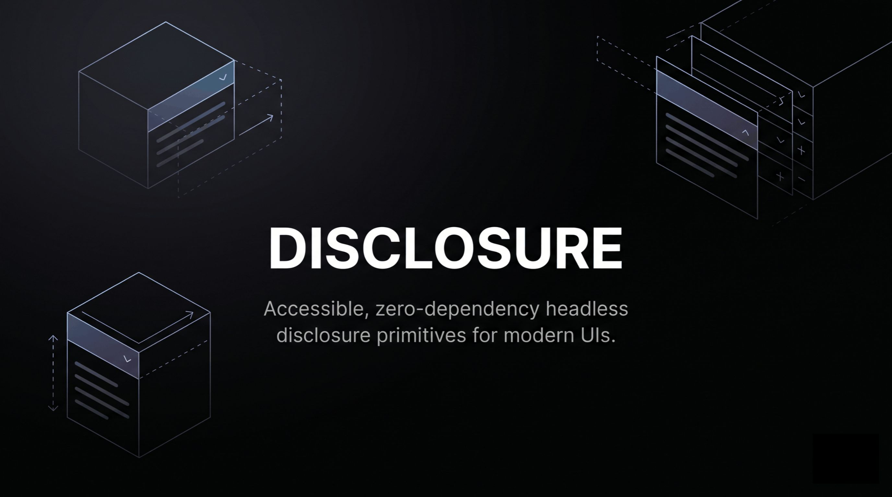

# Disclosure

[English](https://github.com/zealakit/disclosure/blob/main/README.md) | [Tiếng Việt](https://github.com/zealakit/disclosure/blob/main/README_VI.md) | [中文](https://github.com/zealakit/disclosure/blob/main/README_CN.md)



Headless disclosure primitives for modern UI frameworks.

**Disclosure** ships two independent primitives:

- **Collapsible** — a single open/closed panel
- **Accordion** — grouped panels with single or multiple selection

Behavior and accessibility only — no colors, icons, or layout. Height animation is built in and enabled by default. Style with your own CSS via `data-slot` and `data-state`.

> **Note**
>
> Disclosure is not a replacement for a full UI library. Use it when Accordion or Collapsible in your kit is hard to restyle — or when you only need that one primitive and don’t want to pull in a large design system.

## Packages

| Package | Framework | Documentation |
| --- | --- | --- |
| `@zealakit/disclosure-react` | React 18+ | [packages/react/README.md](https://github.com/zealakit/disclosure/blob/main/packages/react/README.md) |
| `@zealakit/disclosure-vue` | Vue 3.5+ | [packages/vue/README.md](https://github.com/zealakit/disclosure/blob/main/packages/vue/README.md) |
| `@zealakit/disclosure-svelte` | Svelte 5 | [packages/svelte/README.md](https://github.com/zealakit/disclosure/blob/main/packages/svelte/README.md) |
| `@zealakit/disclosure-vanilla` | Vanilla JS / static HTML | [packages/vanilla/README.md](https://github.com/zealakit/disclosure/blob/main/packages/vanilla/README.md) |

Each package is independently installable. There is no shared runtime package.

Full API, props, and usage guides live in the package docs linked above.

## Installation

Use your preferred package manager (`npm`, `pnpm`, `yarn`, `bun`, …):

```bash
npm i @zealakit/disclosure-react
npm i @zealakit/disclosure-vue
npm i @zealakit/disclosure-svelte
npm i @zealakit/disclosure-vanilla
```

## Examples

```bash
pnpm install
pnpm build

pnpm dev:react
pnpm dev:vue
pnpm dev:svelte
pnpm dev:vanilla
pnpm dev:nextjs
```

## Dependency monitoring

Local UI for root + `packages/*` dependency versions (`examples/` excluded):

```bash
pnpm monitor
```

Open http://127.0.0.1:4177 — see [monitor/README.md](https://github.com/zealakit/disclosure/blob/main/monitor/README.md).

## AI Agent Skills

Framework-specific instructions for AI coding agents:

- [Disclosure React Skill](https://github.com/zealakit/disclosure/blob/main/skills/disclosure-react.md)
- [Disclosure Vue Skill](https://github.com/zealakit/disclosure/blob/main/skills/disclosure-vue.md)
- [Disclosure Svelte Skill](https://github.com/zealakit/disclosure/blob/main/skills/disclosure-svelte.md)
- [Disclosure Vanilla Skill](https://github.com/zealakit/disclosure/blob/main/skills/disclosure-vanilla.md)

## License

MIT © Zealakit
